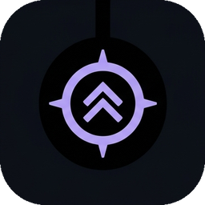

# Focus Walk — notch de escritorio



**Web**: <https://yanzes.github.io/focus-walk/> ·
**Descarga**: [última versión](https://github.com/yanzes/focus-walk/releases/latest)

App nativa de Windows: una ventana sin bordes, transparente y siempre encima, pegada al
borde superior de la pantalla. Se expande al pasar el cursor y reúne la música que estés
reproduciendo en cualquier app, pomodoro, hidratación, estante de archivos y tareas.

## Abrir

Hay dos formas de distribución, ambas sin Node ni npm en el equipo de destino:

**1. Instalador (la normal).** `release/FocusWalk-Setup-0.2.0.exe` → instala en el perfil
del usuario (sin permisos de administrador), deja acceso directo en el Escritorio y en el
menú Inicio, y añade desinstalador en *Aplicaciones instaladas*. Ocupa 116 MB.

```bash
npm run dist      # instalador NSIS completo en release/
npm run dist:dir  # solo la app desempaquetada en release/win-unpacked (para probar rápido)
```

**2. Carpeta portable.** `dist/FocusWalk/FocusWalk.exe`, sin instalar nada.

```bash
npm run build     # crea dist/FocusWalk/FocusWalk.exe (~310 MB, reutiliza el Electron instalado)
```

Durante el desarrollo también sirve **doble clic en `start.bat`**, que abre la app
directamente desde el código: no hay navegador, ni barra de direcciones, ni pestañas.
La ventana mide exactamente lo que el notch, así que no tapa nada del escritorio que no
sea el propio notch; y al ser `resizable: false` no se puede deformar arrastrando un
borde por accidente.

- **Salir**: botón de apagado en el notch, icono de la bandeja → *Salir*, o `Ctrl+Alt+Q`.
- **Desinstalar**: Ajustes → *Desinstalar* (lanza el desinstalador de Windows y conserva tus datos).
- **Mostrar / ocultar**: `Ctrl+Alt+N` o clic en el icono de la bandeja.

> `index.html` a secas **no** funciona: los módulos ES están bloqueados bajo `file://`.
> `web.bat` levanta la misma interfaz en el navegador, solo para depurar.

## Lo que viene del sistema (no es decorado)

| Función | API real de Windows |
| --- | --- |
| Pista, artista, álbum, posición y estado | `Windows.Media.Control` (SMTC) leído del reproductor activo: Spotify, Brave, Edge, Media Player… |
| Play/pausa, siguiente, anterior, buscar | `TryTogglePlayPauseAsync`, `TrySkipNextAsync`, `TrySkipPreviousAsync`, `TryChangePlaybackPositionAsync` |
| Volumen y silencio | WASAPI `IAudioEndpointVolume` (leer, escribir y observar cambios) |
| Bloqueo de Mayús | `GetKeyState(VK_CAPITAL)` |
| Brillo | WMI (`WmiMonitorBrightness`) o DDC/CI (`dxva2.dll`) según el monitor |
| Letras | [LRCLIB](https://lrclib.net) sincronizadas, con caché en disco |
| Carátula | catálogo público de iTunes por artista + título, con coincidencia estricta (si no hay seguridad, degradado) |

El volumen, el brillo y Mayús **se observan**, no se simulan: si bajas el volumen con las
teclas del portátil o activas Mayús, el notch muestra el aviso solo.

> En este equipo el monitor no expone brillo (ni por WMI ni por DDC/CI), así que ese
> control aparece como «No disponible en este monitor» en lugar de fingir un valor.

## Uso

| Acción | Resultado |
| --- | --- |
| Pasar el cursor por el notch | Se expande |
| Clic en el pin | Lo deja abierto |
| `Esc` | Cierra y suelta el pin |
| `←` `→` o `1`–`6` | Cambia de página |
| Arrastrar archivos sobre el estante | Se guardan entre sesiones |

Páginas: **Música**, **Enfoque** (pomodoro con hora de fin real), **Agua** (registro
diario y gráfico de 7 días), **Estante**, **Tareas** y **Ajustes**.

## Arquitectura

```
electron/
  main.cjs              ventana nativa, protocolo app://, bandeja, atajos, IPC
  preload.cjs           puente: tamaño de ventana + API del sistema
  system.cjs            cliente del puente con reconexión automática
  lyrics.cjs            LRCLIB + caché en disco
  artwork.cjs           carátulas por metadatos (iTunes, con match estricto)
  native/system-bridge.ps1   proceso PowerShell que habla con Windows
index.html              interfaz (sin build, módulos ES)
styles/                 tokens.css (identidad), base, notch, pages
src/
  boot.js               modo escritorio + aviso si se abre como archivo local
  native.js             sincroniza el tamaño de la ventana con el notch
  system.js             estado real del sistema en la interfaz
  media.js              fuente de reproducción (sistema o demo)
  notch.js              estados, pestañas, teclado, píldora
  player.js             reloj de demo (solo navegador)
  focus.js              pomodoro
  overlays.js           volumen / brillo / Mayús
  store.js              estado + localStorage + bus de eventos
  osd.js  ui.js         avisos y helpers
  pages/*.js            una página por módulo
assets/                 icon.ico, icon.png, tray.png (tools/make-icons.py)
scripts/build-portable.cjs   empaqueta dist/FocusWalk/FocusWalk.exe sin descargar nada
electron-builder.yml    instalador NSIS (npm run dist)
```

**Por qué el paquete va sin asar.** La app arranca `electron/native/system-bridge.ps1` con
un proceso externo de PowerShell, y Windows no puede abrir archivos dentro de un `.asar`.
Con `asar: false`, la ruta que calcula `system.cjs` desde `__dirname` apunta a un archivo
real y el puente funciona. electron-builder avisa de que es «poco recomendable»; aquí es
deliberado: activar asar deja la app sin música, volumen ni Mayús, y arreglarlo exigiría
reescribir esa ruta a `app.asar.unpacked`.

**El puente**: `main.cjs` lanza `system-bridge.ps1`, que abre una named pipe
`\\.\pipe\focuswalk-system`. Por ahí emite líneas JSON con el estado (solo cuando cambia) y
recibe comandos (`toggle`, `next`, `seek`, `volume`, `mute`, `brightness`). Si el proceso
muere, se reinicia con espera creciente y la interfaz sigue funcionando con lo último
conocido. Usa un proceso persistente porque arrancar PowerShell en cada pulsación
costaría ~400 ms.

**La ventana** mide exactamente lo que el notch: crece al instante y se encoge 520 ms
después (cuando termina la animación), para no recortarlo. Cuando aparece un aviso del
sistema, la ventana crece ~104 px hacia abajo y vuelve al desaparecer.

Ventana de escritorio: `frame: false` (sin bordes ni barra de título), `transparent: true`
con fondo `#00000000` y `hasShadow: false` (las esquinas de fuera del notch son
transparentes de verdad, alfa 0), `alwaysOnTop` con nivel `floating`, `skipTaskbar` (no
ocupa sitio en la barra de tareas), sin menú, `resizable: false` y `movable: false`. Se
muestra con `showInactive()` para no robar el foco a lo que estés escribiendo, y se
recentra sola si cambias de resolución o desconectas un monitor.

El protocolo `app://` sirve los archivos con su MIME correcto; así los módulos ES y
`localStorage` funcionan con un origen propio, sin abrir ningún puerto.

## Tus diseños

Todo sale de [`styles/tokens.css`](styles/tokens.css): acento, superficies, jerarquía de
texto, radios, movimiento y tipografía. Los cinco acentos de Ajustes son bloques
`[data-accent="…"]`; añadir el tuyo es copiar uno.

En modo escritorio el notch es **opaco** a propósito: una ventana transparente no puede
difuminar el escritorio de detrás, así que el `backdrop-filter` se desactiva.

### Iconos

Salen del mockup aprobado, sin retocar a mano:

```bash
python tools/make-icons.py "C:\ruta\al\mockup.jpg"   # recorta y regenera assets/
```

El script localiza el recuadro en el mockup, le devuelve la transparencia a las esquinas,
y escribe `icon.png` (256), `icon-512.png`, `icon.ico` (256→16) y `tray.png`. La bandeja
no reutiliza el recuadro: a 16 px el detalle del círculo se emborrona, así que ahí va solo
el doble chevron en `#7C5CFF`, que se lee sobre barra clara y oscura. `npm run build`
estampa el `.ico` dentro del `.exe` con rcedit.

## Apoyo y donaciones

<a href="https://ko-fi.com/focuswalk">Invítame a un café</a> — un pago único y voluntario,
sin suscripción y sin desbloquear nada: la app ya está completa.

Dónde vive el enlace **en un solo sitio**: [src/support.js](src/support.js) (`DONATE_URL`).
Lo usan el recordatorio y Ajustes; si lo cambias, hazlo también en
[docs/index.html](docs/index.html), que es la página de publicación.

- **Recordatorio**: a los 15 días de la primera apertura aparece una tarjeta bajo el
  notch con *Invitar* / *Ahora no* / *No volver a mostrar*. `Ahora no` lo aplaza 15 días;
  invitar lo aplaza 30.
- **Silenciarlo**: Ajustes → *Apoyo* → *Recordarme*, o el propio enlace de la tarjeta.
- **Página de publicación**: [docs/index.html](docs/index.html). Es un archivo estático
  (GitHub Pages) con la descarga, las funciones y la sección de donaciones.

## Publicar en GitHub

La página vive en `docs/` y los botones de descarga apuntan a una **Release**.
El instalador no puede ir en el repositorio: pesa 116 MB y GitHub rechaza cualquier
archivo de más de 100 MB (y avisa a partir de 50 MB). Las releases admiten hasta 2 GB
por asset, así que es el único sitio correcto para él.

**1. Subir el código** (solo una vez):

```bash
git remote add origin https://github.com/yanzes/focus-walk.git
git push -u origin main
```

El repositorio debe ser público: Pages es gratis, pero en un repositorio privado exige
plan de pago.

**2. Activar la web**: repositorio → *Settings* → *Pages* → *Build and deployment* →
*Deploy from a branch* → rama `main`, carpeta `/docs` → *Save*. Queda en
`https://yanzes.github.io/focus-walk/` (tarda un minuto).

**3. Publicar el instalador**: repositorio → *Releases* → *Draft a new release* →
tag `v0.2.0` → adjunta `release/FocusWalk-Setup-0.2.0.exe` → *Publish release*.

**4. Enlazarlo**: en [docs/index.html](docs/index.html), al final, están las dos únicas
constantes que hay que tocar:

```js
const REPO = "yanzes/focus-walk";                    // USUARIO/repositorio
const INSTALLER = "FocusWalk-Setup-0.2.0.exe";         // nombre exacto del asset
```

Con eso los dos botones de descarga apuntan a
`https://github.com/REPO/releases/latest/download/INSTALLER`, que siempre sirve el
instalador de la última release. Al sacar una versión nueva basta con cambiar `INSTALLER`.
Si el repositorio todavía no existe, los botones llevan a la página de releases, donde el
archivo se puede bajar a mano.

## Pendiente

1. **Arrastrar archivos fuera** de la ventana (`IDropTarget` / `SHCreateDataObject`).
2. **Arranque con Windows** y **firma de código**: el instalador ya existe, pero no se
   inicia con el sistema y, al no estar firmado, SmartScreen avisa la primera vez.
3. **Carátula desde SMTC**: el thumbnail existe, pero PowerShell 5.1 lo entrega como COM
   sin proyección de interfaz (los streams WinRT no son accesibles). Hoy la portada sale
   del catálogo de iTunes. En un host nativo (Tauri/Rust) sí se podría leer el stream real.
4. Si el consumo importa, migrar el host a **Tauri** reutilizando la interfaz tal cual
   (requiere Rust + MSVC Build Tools, no instalados aquí).

## Auto-test

```bash
npx electron . --self-test   # ejercita botones, páginas, música real y redimensionado
npx electron . --probe       # mide geometría y colores de la ventana
npx electron . --probe --coffee   # además fuerza el aviso del café y lo captura
npx electron . --uninstall-dry    # busca el desinstalador sin ejecutarlo
dist/FocusWalk/FocusWalk.exe --self-test   # lo mismo sobre la copia empaquetada
```

El auto-test no toca tu reproducción: lee la pista y los controles, pero no pulsa play ni
cambia el volumen del sistema.
